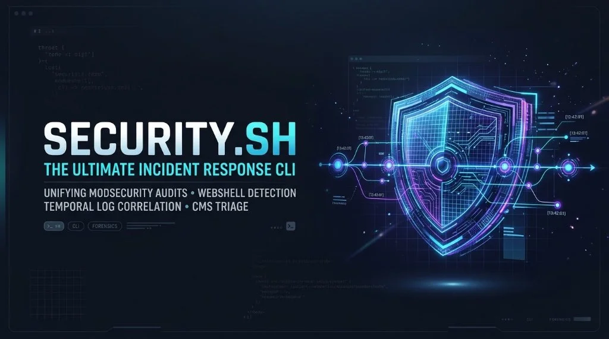

[](README.md) [](README-ptbr.md) [](README-es.md)

# security



[](https://github.com/sr00t3d/security/releases/tag/v2.0.0)
[](LICENSE)
[](#requisitos)
[](#requisitos)

**Orquestrador Unificado de Triagem de Incidentes & Forense em Hospedagem (`security.sh`).**

O `security.sh` reúne 4 estágios de resposta a incidentes em uma única CLI standalone (Bash + Python 3.6+): **(1) auditoria ModSecurity EA4**, **(2) varredura symlink-safe de webshells/payloads codificados com linha do tempo do Paciente Zero (`mtime`/`ctime`)**, **(3) correlação temporal de logs (`+/- --window` seg) com Apache/cPanel** e **(4) detecção de versão CMS (WordPress/Joomla)** — com modo somente-leitura por padrão e quarentena `0700` reversível via `restore`.

> **Inspiração Histórica:** Reimplementação limpa em Bash + Python 3.6+ (`v2.0.0`) inspirada no clássico `security.pl` (2012, Michael Karr, HostGator.com, LLC).

---

## Execução Direta

```bash
curl -fsSL https://raw.githubusercontent.com/sr00t3d/security/main/security.sh -o security.sh
chmod +x security.sh
sudo ./security.sh -p /var/www/html --exit-code
```

---

## Exemplo de Saída Real

```text
==================================================================================================
 security.sh v2.0.0 | Incident Triage | /tmp/security-e2e/webroot | 2026-11-24T03:43:15Z
==================================================================================================
SEVERITY  SIGNATURE                   MTIME_UTC            ACTION    PATH
--------  --------------------------  -------------------  --------  --------------------------------------------------
HIGH      PHP.Webshell.EvalEncoded    2026-11-22 14:10:00  DETECTED  /tmp/security-e2e/webroot/wp-content/shell.php
CRITICAL  PHP.Webshell.UserInputExec  2026-11-22 14:12:00  DETECTED  /tmp/security-e2e/webroot/cmd.php

Patient Zero: /tmp/security-e2e/webroot/wp-content/shell.php (mtime=2026-11-22 14:10:00, ctime=2026-11-22 14:10:00)
Log Hits (+/-120s):
  - [2026-11-22 14:09:50] 198.51.100.44 (200) POST /wp-admin/admin-ajax.php HTTP/1.1
CMS Detected: WordPress 6.6.2 (/tmp/security-e2e/webroot)
```

---

## Licença

Distribuído sob a licença [Apache License 2.0](LICENSE).
